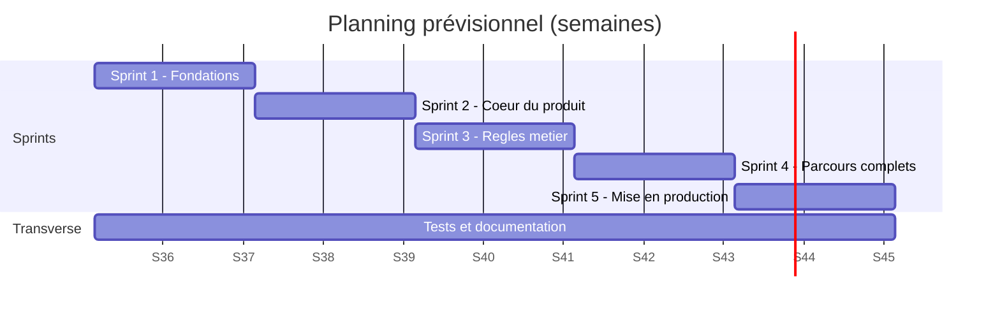

# Compétence 4 — Gestion du projet

## Méthode : Scrum allégé (projet individuel)

Le projet est mené seul : les rôles Scrum sont tenus par la même personne, mais les cérémonies sont conservées sous une forme courte pour garder le cadre de travail.

| Élément | Pratique retenue |
|---|---|
| Product Owner | Définit et priorise le backlog à partir du cahier des charges |
| Sprints | 2 semaines, un objectif clair par sprint |
| Planification | Choix des user stories du sprint selon la vélocité (points : 1, 2, 3, 5, 8) |
| Point quotidien | 5 minutes par écrit : fait / à faire / blocages |
| Revue de sprint | Démonstration de l'incrément (application lançable avec `docker compose`) |
| Rétrospective | Ce qui a bien marché, ce qu'on améliore, une action concrète |
| Definition of Done | Voir ci-dessous (reprise dans `.github/pull_request_template.md`) |

**Definition of Done** : code relu via Pull Request, lint sans erreur, tests écrits et verts, saisies validées côté serveur, accessibilité contrôlée, documentation à jour, CI verte.

## Outils de suivi

- **GitHub Projects** (tableau Kanban : `Backlog → Sprint → En cours → En revue → Terminé`) rattaché au dépôt, avec les *issues* créées à partir du modèle `user_story`.
- **GitHub Issues** et étiquettes (`user-story`, `bug`, `securite`, `documentation`) ; jalons (*milestones*) = sprints.
- **Pull Requests** liées aux tickets (`Closes #n`) ; protection de la branche `main` (CI obligatoire).
- Workflow Git décrit dans [CONTRIBUTING.md](../CONTRIBUTING.md).

> Le tableau GitHub Projects se renseigne depuis le backlog ci-dessous : une issue par ligne.

## Découpage : epics et backlog priorisé

Priorité : **M** = MVP (points 1 à 6 et 10 du cahier des charges), **S** = souhaitable, **C** = si le temps le permet.

| ID | Epic | User story (résumé) | Prio | Pts | Sprint |
|---|---|---|---|---|---|
| US1 | Environnement | Dépôt, Docker Compose, CI de base, lint | M | 3 | 1 |
| US2 | Authentification | S'inscrire avec un mot de passe haché | M | 3 | 1 |
| US3 | Authentification | Se connecter, session sécurisée, rôles | M | 5 | 1 |
| US4 | Authentification | Verrouillage après échecs, réinitialisation par email | S | 5 | 4 |
| US5 | Ressources | Consulter et filtrer le catalogue | M | 5 | 2 |
| US6 | Ressources | Administrateur : créer, modifier, désactiver | M | 5 | 2 |
| US7 | Base de données | Schéma PostgreSQL, contraintes, droits, migrations | M | 5 | 1 |
| US8 | Réservation | Réserver un créneau avec motif | M | 8 | 2 |
| US9 | Réservation | Calendrier jour / semaine / mois, code couleur | M | 8 | 3 |
| US10 | Conflits | Refuser un chevauchement (application + base) | M | 5 | 2 |
| US11 | Conflits | Proposer des créneaux alternatifs | S | 3 | 3 |
| US12 | Quotas | Limiter réservations actives, durée, délai par profil | M | 5 | 3 |
| US13 | Quotas | Afficher le quota restant ; administrateur : éditer les quotas | S | 3 | 3 |
| US14 | Workflow | Statuts et validation / refus motivé par le responsable | M | 8 | 3 |
| US15 | Audit | Journal d'audit MongoDB (qui, quoi, quand, avant/après) | M | 5 | 3 |
| US16 | Espace personnel | Voir, modifier, annuler ses réservations | S | 5 | 4 |
| US17 | Notifications | Emails + notifications internes + rappel la veille | S | 5 | 4 |
| US18 | Tableaux de bord | Espace responsable + statistiques administrateur | S | 8 | 4 |
| US19 | RGPD | Export des données, suppression du compte | S | 3 | 4 |
| US20 | Accessibilité | Audit RGAA, navigation clavier, lecteur d'écran | M | 5 | 4 |
| US21 | Tests | Plan de tests, tests unitaires, intégration, sécurité | M | 8 | 1–5 |
| US22 | DevOps | Image Docker, CI/CD, déploiement recette et production | M | 8 | 5 |
| US23 | Documentation | Dossier technique, procédure de déploiement | M | 5 | 5 |
| US24 | Extension | Réservations récurrentes (tous les lundis 14h–16h) | C | 8 | — |

## Planning prévisionnel (5 sprints de 2 semaines)

| Sprint | Objectif | Livrable démontrable |
|---|---|---|
| 1 | Fondations | Dépôt, Docker, schéma de base, inscription et connexion |
| 2 | Cœur du produit | Catalogue, réservation simple, refus des conflits |
| 3 | Règles métier | Calendrier, quotas, workflow de validation, audit MongoDB |
| 4 | Parcours complets | Espaces personnel / responsable / admin, notifications, RGPD, accessibilité |
| 5 | Mise en production | Tests finalisés, CI/CD, déploiement recette puis production, documentation |

*Les dates sont indicatives : à ajuster au calendrier réel de la formation.*

## Gestion des risques

| Risque | Probabilité | Impact | Mesure |
|---|---|---|---|
| Périmètre trop large | Élevée | Élevé | MVP strict (points 1–6 et 10), extensions classées « souhaitables » |
| Conflits de réservation en accès concurrent | Moyenne | Élevé | Contrainte d'exclusion PostgreSQL + test de concurrence |
| Faille de sécurité | Moyenne | Élevé | Validation systématique, tests de sécurité automatisés, audit des dépendances en CI |
| Perte de données | Faible | Élevé | Volumes Docker nommés, procédure de sauvegarde ([09-deploiement.md](09-deploiement.md)) |
| Indisponibilité d'un service tiers (SMTP) | Moyenne | Faible | Notifications internes en repli, un échec d'email n'annule jamais une réservation |
