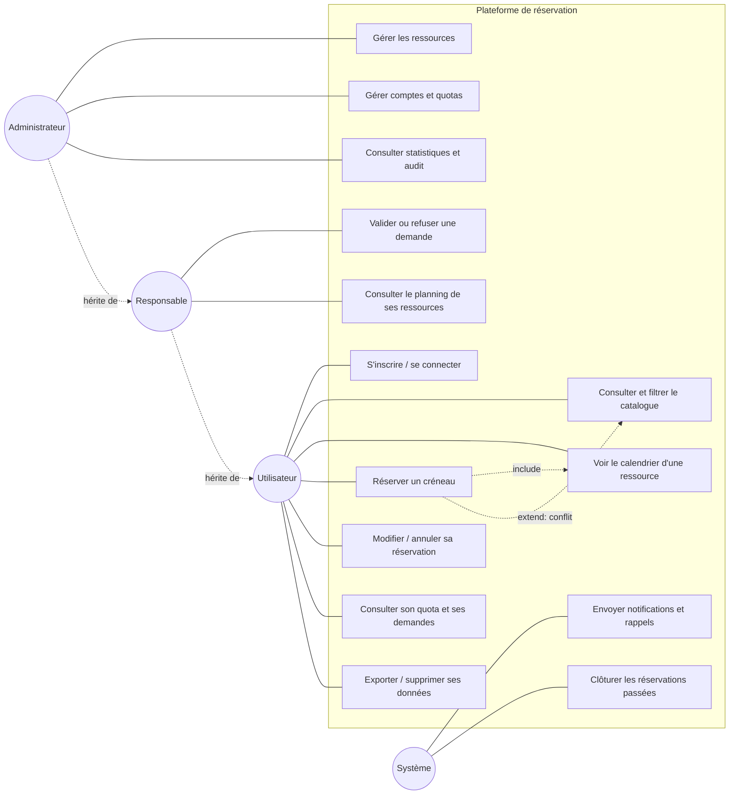
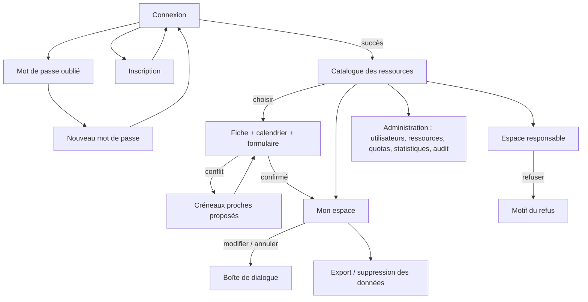

# Compétence 5 — Analyse des besoins

## Acteurs

| Acteur | Rôle dans le système |
|---|---|
| **Utilisateur** | Consulte les ressources, réserve, gère ses propres réservations. Profil de quota : élève, personnel ou enseignant. |
| **Responsable** | Valide ou refuse les demandes concernant les ressources dont il a la charge ; peut annuler une réservation. |
| **Administrateur** | Gère comptes, ressources, quotas ; consulte statistiques et journal d'audit. |
| **Système** (acteur secondaire) | Envoie les notifications, clôture les réservations passées, envoie les rappels. |

## Diagramme de cas d'utilisation

*Le responsable et l'administrateur disposent aussi de toutes les fonctions de l'utilisateur.*

## User stories et critères d'acceptation

### Authentification et comptes
- **US2/US3** — *En tant que visiteur, je veux créer un compte et me connecter afin d'accéder aux réservations.*
  - Le mot de passe fait au moins 10 caractères avec majuscule, minuscule et chiffre.
  - Le mot de passe n'est jamais stocké en clair (bcrypt).
  - Un identifiant ou un mot de passe incorrect donne le même message, sans révéler si le compte existe.
  - Après connexion, la session expire au bout de 2 h.
- **US4** — *En tant qu'utilisateur, je veux que mon compte soit protégé contre les attaques par force brute.*
  - Après 5 échecs consécutifs, le compte est verrouillé 15 minutes, même avec le bon mot de passe.
  - Je peux réinitialiser mon mot de passe via un lien reçu par email, valable 1 heure et à usage unique.

### Catalogue
- **US5** — *En tant qu'utilisateur, je veux filtrer les ressources par type, capacité et disponibilité à une date.*
  - Chaque fiche affiche nom, type, capacité, localisation, équipements, horaires d'ouverture et validation requise.
  - Une ressource complète à la date choisie est signalée « Complet ce jour ».
- **US6** — *En tant qu'administrateur, je veux ajouter, modifier ou désactiver une ressource (maintenance).*
  - Une ressource désactivée est masquée aux utilisateurs et impossible à réserver ; le motif est affiché.

### Réservation
- **US8/US9** — *En tant qu'utilisateur, je veux choisir une ressource, une date, une heure de début et de fin et un motif.*
  - Les créneaux sont de 30 minutes, dans les horaires d'ouverture, sur une seule journée, dans le futur.
  - Le calendrier (jour, semaine, mois) distingue libre, occupé, en attente, ma réservation, passé, **par du texte et un motif, pas seulement par la couleur**.
- **US10/US11** — *En tant qu'utilisateur, je veux être informé quand mon créneau est pris et recevoir des alternatives.*
  - Un chevauchement est refusé (code 409), y compris si deux personnes réservent exactement au même moment.
  - Trois créneaux libres proches, de même durée, sont proposés ; un clic les applique au formulaire.
  - Des créneaux qui se touchent (fin = début suivant) ne sont pas en conflit.
- **US12/US13** — *En tant qu'administrateur, je veux limiter les abus.*
  - Trois règles par profil : nombre de réservations actives, durée maximale, délai maximal à l'avance.
  - L'utilisateur voit son quota restant sur son tableau de bord et sur la page de réservation.
  - Des demandes simultanées ne peuvent pas dépasser le quota.

### Validation
- **US14** — *En tant que responsable, je veux valider ou refuser les demandes de mes ressources.*
  - Statuts : `en_attente → validee / refusee → terminee / annulee`. Les états finaux sont définitifs.
  - Un refus exige un motif, transmis au demandeur.
  - Un responsable ne traite que ses ressources ; un utilisateur ne peut pas décider.
  - Sur une ressource à réservation libre, la réservation est directement validée.

### Espace personnel et pilotage
- **US16** — *En tant qu'utilisateur, je veux voir mes réservations à venir et passées, en modifier ou annuler une.*
  - Modification possible jusqu'à 24 h avant le début ; sur une ressource contrôlée, elle repasse « en attente ».
  - On ne voit ni ne modifie les réservations d'autrui.
- **US17** — *En tant qu'utilisateur, je veux être prévenu des événements importants.*
  - Notification interne et email pour : demande reçue (responsable), validation, refus, annulation par le responsable, rappel (dans les 24 h avant le début).
- **US18** — *En tant qu'administrateur, je veux des statistiques.*
  - Taux d'occupation par ressource, ressources les plus demandées, créneaux les plus saturés, nombre d'annulations, répartition par statut.
- **US15** — *En tant qu'administrateur, je veux tracer les actions importantes.*
  - Chaque événement (connexion, échec, création, modification, annulation, validation, changement de droits, export, suppression) est journalisé avec acteur, cible, avant/après et adresse IP.
- **US19** — *En tant qu'utilisateur, je veux exercer mes droits RGPD.*
  - Export JSON de toutes mes données ; suppression de compte (anonymisation).

## Enchaînement des écrans

## Exigences non fonctionnelles

| Domaine | Exigence |
|---|---|
| Sécurité | Voir [11-securite-rgpd-rgaa.md](11-securite-rgpd-rgaa.md) |
| Accessibilité | Conformité RGAA visée : navigation clavier, labels, contrastes, annonces vocales |
| Éco-conception | Pas de framework ni de police externe, images chargées à la demande, compression, cache |
| Performance | Objectif : réponse API < 200 ms sur les opérations courantes ; index sur les colonnes de recherche |
| Fiabilité | Aucun double booking, même en accès concurrent ; une panne d'email ou d'audit ne bloque pas une réservation |
| Conformité | RGPD : minimisation, conservation limitée des logs (365 jours), accès et effacement |
