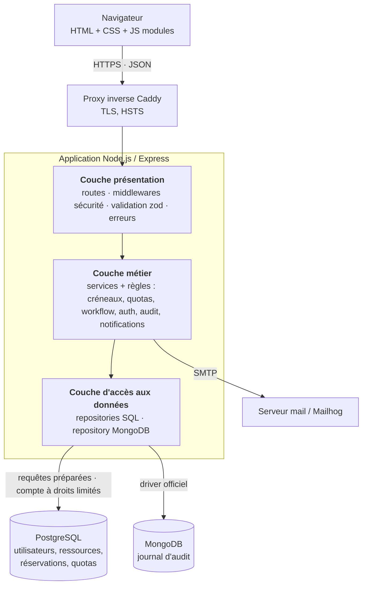
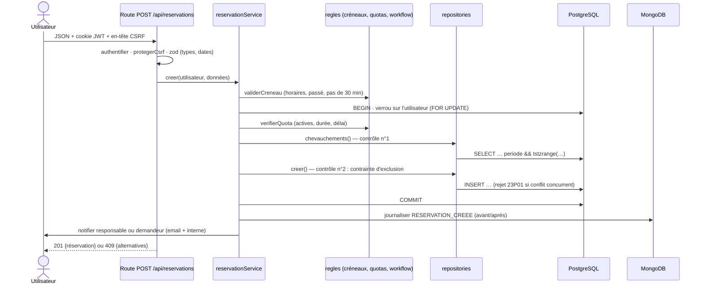

# Compétences 3 et 6 — Architecture logicielle

## Vue d'ensemble



## Responsabilités des couches

| Couche | Dossier | Rôle | Interdit |
|---|---|---|---|
| **Présentation** | `src/presentation/` | Reçoit la requête HTTP, authentifie, contrôle le rôle, **valide la saisie** (`schemas.js`), appelle un service, formate la réponse, traduit les erreurs | Contenir une règle de gestion ; écrire du SQL |
| **Métier** | `src/services/` | Règles de gestion, orchestration, transactions, journalisation, notifications. `regles/` contient des fonctions **pures** (sans E/S), donc testables unitairement | Connaître Express (`req`, `res`) |
| **Accès aux données** | `src/repositories/`, `src/db/` | Seule couche qui parle à PostgreSQL et MongoDB ; requêtes préparées ; renvoie des objets simples | Appliquer une règle métier |

Les dépendances vont toujours vers le bas. Le frontend (`public/`) ne connaît que l'API JSON.

### Exemple : réserver un créneau



## Choix techniques justifiés (ADR résumés)

| Décision | Alternatives | Raison |
|---|---|---|
| **Monolithe en couches** plutôt que microservices | Microservices | Projet à une personne, un seul domaine : la séparation en couches apporte la maintenabilité sans la complexité réseau et d'exploitation. |
| **Deux bases** : PostgreSQL + MongoDB | Tout en PostgreSQL (JSONB) | Les données métier sont relationnelles et exigent des contraintes d'intégrité (clés étrangères, exclusion). Le journal est volumineux, à structure variable, sans jointure : cas d'usage naturel du NoSQL, avec index TTL pour la conservation limitée. |
| **Contrainte d'exclusion PostgreSQL** en plus du contrôle applicatif | Contrôle applicatif seul | Un contrôle applicatif seul laisse passer deux réservations simultanées. La base est l'arbitre final ; l'application fournit des messages et des alternatives. |
| **JWT dans un cookie HttpOnly + SameSite=Strict + jeton CSRF** | JWT en `localStorage` ; sessions serveur | Le cookie HttpOnly n'est pas lisible par un script (impact réduit d'une XSS). Le rôle est relu en base à chaque requête : un compte désactivé est révoqué immédiatement. |
| **bcrypt** | Argon2 | Autorisé par le cahier des charges ; pur JavaScript, sans compilation native. Coût 12 (≈ 250 ms). |
| **Frontend sans framework** | React, Vue | Éco-conception, surface d'attaque XSS minimale, maîtrise totale de l'accessibilité. Compromis : plus de code de gabarit manuel. |
| **API JSON REST** | GraphQL | Besoins simples et stables, outillage plus léger, tests plus directs. |
| **Migrations SQL versionnées** | ORM avec synchronisation automatique | Contrôle total du schéma (contraintes avancées), historique reproductible dans `schema_migrations`. |

## Conformité aux recommandations de sécurité de l'ANSSI

Référentiels pris en compte : *Recommandations de sécurité relatives à un système GNU/Linux*, *Recommandations pour la sécurisation des sites web* (ANSSI-PA-009), *Recommandations relatives à l'authentification multifacteur et aux mots de passe* (ANSSI-PG-078), *Recommandations de sécurité pour la configuration TLS*, *Guide d'hygiène informatique*.

| Recommandation ANSSI | Mise en œuvre |
|---|---|
| Cloisonner les couches et limiter les privilèges | Architecture 3 couches ; base accessible uniquement depuis le réseau Docker interne ; compte applicatif sans droit DDL, sans `DELETE` sur les utilisateurs ni les réservations ; conteneur applicatif non-root |
| Valider toutes les entrées (côté serveur) | Schémas zod sur chaque route (types, longueurs, formats, refus des champs inconnus) ; paramètres de requête typés |
| Se protéger des injections | Requêtes préparées partout ; filtres Mongo typés ; LIKE échappé |
| Authentification robuste | Mots de passe : 10 caractères minimum avec 3 classes, hachés bcrypt coût 12 ; verrouillage après 5 échecs ; message d'erreur identique ; réinitialisation par jeton aléatoire de 256 bits stocké haché (SHA-256), valable 1 h, à usage unique |
| Protéger les sessions | Cookie `HttpOnly`, `SameSite=Strict`, `Secure` en production ; expiration 2 h ; algorithme JWT imposé (HS256) ; pas de secret en dur : démarrage refusé sans `JWT_SECRET` fort |
| Contrôle d'accès côté serveur | Rôle relu en base à chaque requête ; contrôle de propriété (anti-IDOR) ; responsable limité à ses ressources |
| Chiffrer les échanges | HTTPS obligatoire en production (Caddy, TLS automatique), HSTS, cookie `Secure` |
| Protéger contre XSS / CSRF / clickjacking | CSP stricte sans `unsafe-inline`, aucune injection de HTML dans l'interface, double soumission de cookie CSRF + contrôle d'`Origin`, `frame-ancestors 'none'` |
| Journaliser et superviser | Journal d'audit MongoDB (actions sensibles, échecs de connexion, IP), journaux applicatifs sans données sensibles |
| Limiter les attaques par déni de service | Limitation de débit (30 requêtes / 15 min sur l'authentification, 600 sur l'API), corps de requête limité à 50 Ko |
| Gérer les secrets | Variables d'environnement, `.env` ignoré par Git, modèle `.env.prod.example`, secrets CI dans GitHub Secrets |
| Maintenir à jour | `npm audit` en CI (échec si vulnérabilité haute), analyse Trivy de l'image Docker, images officielles à jour |
| Minimiser les données | Voir RGPD dans [11-securite-rgpd-rgaa.md](11-securite-rgpd-rgaa.md) |

## Structure du dépôt

```
src/
  server.js, app.js, config.js
  presentation/  routes/ · middlewares/ (securite, erreurs) · schemas.js
  services/      reservationService, authService, adminService, ressourceService,
                 auditService, notificationService, regles/ (creneaux, quotas, workflow)
  repositories/  utilisateurRepo, ressourceRepo, reservationRepo, statsRepo, notificationRepo, auditRepo
  db/            postgres.js (pool, transactions) · mongo.js
  utils/         erreurs.js, temps.js (fuseau horaire)
db/migrations/   001_init.sql
scripts/         init-db.js (migrations + droits) · seed.js (démo)
public/          index.html · css/ · js/ (app, api, dom, calendrier, pages/)
tests/           unit/ · integration/ · security/
deploy/          Caddyfile · .env.prod.example
docs/            documentation technique
```
