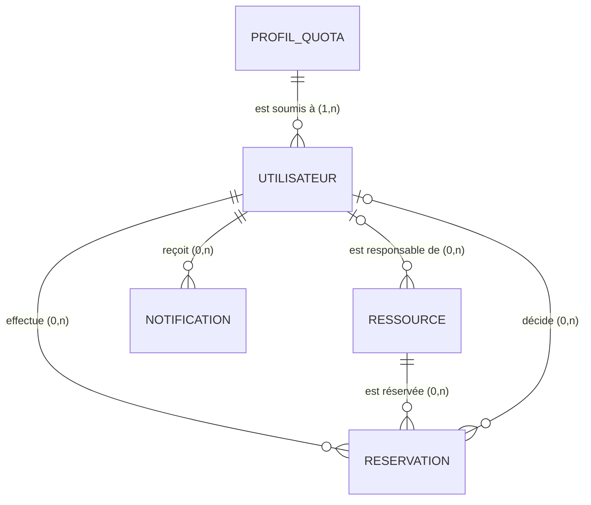

# Compétence 7 — Base de données relationnelle

## Règles de gestion

1. Un utilisateur a un rôle (utilisateur, responsable, admin) et **un** profil de quota.
2. Une ressource a **au plus un** responsable ; un responsable peut gérer plusieurs ressources.
3. Une réservation concerne **une** ressource et **un** utilisateur ; une ressource et un utilisateur ont plusieurs réservations.
4. Deux réservations actives (`en_attente` ou `validee`) ne se chevauchent jamais sur la même ressource.
5. Une réservation a un début strictement antérieur à sa fin.
6. Un utilisateur reçoit plusieurs notifications ; elles disparaissent avec le compte.
7. Les réservations ne sont jamais supprimées (statistiques, traçabilité) : un compte supprimé est **anonymisé**.

## MCD (Merise)



Cardinalités (côté entité → association) : PROFIL_QUOTA (1,1)–(0,n) UTILISATEUR ; UTILISATEUR (0,n)–(0,1) RESSOURCE ; UTILISATEUR (1,1)–(0,n) RESERVATION ; RESSOURCE (1,1)–(0,n) RESERVATION ; UTILISATEUR (1,1)–(0,n) NOTIFICATION.

### Dictionnaire de données

| Entité | Propriété | Type | Contrainte |
|---|---|---|---|
| PROFIL_QUOTA | id, code, libelle | entier, texte | code unique |
| | max_reservations_actives, duree_max_minutes, delai_max_jours | entiers | > 0 |
| UTILISATEUR | id, email, mot_de_passe_hash, prenom, nom | | email unique, en minuscules |
| | role, actif, tentatives_echec, verrouille_jusqua | | rôle ∈ {utilisateur, responsable, admin} |
| | reset_token_hash, reset_expire_le, cree_le, anonymise_le | | jeton stocké haché |
| RESSOURCE | id, nom, type, capacite, localisation, equipements, photo_url | | nom unique, capacité ≥ 1, type ∈ {salle, materiel} |
| | heure_ouverture, heure_fermeture, validation_requise, active, motif_indisponibilite | | fermeture > ouverture |
| RESERVATION | id, debut, fin, motif, statut, motif_decision, decide_le, rappel_envoye | | fin > début, statut ∈ 5 valeurs |
| NOTIFICATION | id, type, message, lue, cree_le | | |

## MLD (relationnel)

```
PROFIL_QUOTA   (#id, code, libelle, max_reservations_actives, duree_max_minutes, delai_max_jours)
UTILISATEUR    (#id, email, mot_de_passe_hash, prenom, nom, role, actif, tentatives_echec,
                verrouille_jusqua, reset_token_hash, reset_expire_le, cree_le, anonymise_le,
                #profil_quota_id → PROFIL_QUOTA)
RESSOURCE      (#id, nom, type, capacite, localisation, equipements, photo_url, heure_ouverture,
                heure_fermeture, validation_requise, active, motif_indisponibilite, cree_le,
                #responsable_id → UTILISATEUR [nullable])
RESERVATION    (#id, debut, fin, motif, statut, motif_decision, decide_le, rappel_envoye, cree_le, maj_le,
                #ressource_id → RESSOURCE, #utilisateur_id → UTILISATEUR, #decide_par → UTILISATEUR [nullable])
NOTIFICATION   (#id, type, message, lue, cree_le, #utilisateur_id → UTILISATEUR)
```

Toutes les relations 1,n sont portées par une clé étrangère côté « n » : aucune table associative n'est nécessaire. Le modèle est en **3ᵉ forme normale** : le profil de quota est factorisé dans sa propre table ; aucune donnée dérivée n'est stockée, hors la colonne calculée `periode`, générée par la base à partir de `debut` et `fin`.

## MPD (PostgreSQL 16)

Script complet : [`db/migrations/001_init.sql`](../db/migrations/001_init.sql). Points clés :

| Mécanisme | Définition | Rôle |
|---|---|---|
| Types énumérés | `role_utilisateur`, `type_ressource`, `statut_reservation` | Valeurs interdites rejetées par la base |
| Clés étrangères | `ON DELETE RESTRICT` (réservations), `SET NULL` (responsable), `CASCADE` (notifications) | Intégrité référentielle |
| `CHECK` | `fin > debut`, `heure_fermeture > heure_ouverture`, `capacite >= 1`, `email = lower(email)`, quotas > 0 | Intégrité de domaine |
| `UNIQUE` | `utilisateurs.email`, `ressources.nom`, `profils_quota.code` | Pas de doublon |
| Colonne générée | `periode TSTZRANGE GENERATED ALWAYS AS (tstzrange(debut, fin, '[)')) STORED` | Intervalle semi-ouvert : deux créneaux contigus ne se chevauchent pas |
| **Contrainte d'exclusion** | `EXCLUDE USING gist (ressource_id WITH =, periode WITH &&) WHERE (statut IN ('en_attente','validee'))` | Interdit tout chevauchement actif, même en concurrence (extension `btree_gist`) |
| Index | `reservations(utilisateur_id, debut)`, `(ressource_id, debut)`, `(statut)`, `notifications(utilisateur_id, lue)`, `ressources(responsable_id)` | Espace perso, calendrier, tableaux de bord |
| Déclencheur | `trg_reservations_maj` | Met à jour `maj_le` |
| Migrations | Table `schema_migrations`, application transactionnelle dans `scripts/init-db.js` | Évolutions reproductibles et traçables |

La contrainte d'exclusion est vérifiée par un test qui contourne l'application (`tests/integration/api.test.js`, « la base refuse elle-même un chevauchement ») et par un test de réservations simultanées : sur quatre requêtes parallèles, une seule réussit.

## Gestion des droits d'accès

Deux comptes PostgreSQL distincts (principe du moindre privilège) :

| Compte | Utilisé par | Droits |
|---|---|---|
| `postgres` (administrateur) | Conteneur ponctuel `migrate` uniquement | Tous (création du schéma) |
| `resa_app` (applicatif) | Application en fonctionnement | Voir tableau ci-dessous |

| Table | SELECT | INSERT | UPDATE | DELETE |
|---|:-:|:-:|:-:|:-:|
| utilisateurs | ✔ | ✔ | ✔ | ✘ (anonymisation à la place) |
| ressources | ✔ | ✔ | ✔ | ✘ (désactivation à la place) |
| reservations | ✔ | ✔ | ✔ | ✘ |
| profils_quota | ✔ | ✘ | ✔ | ✘ |
| notifications | ✔ | ✔ | ✔ | ✔ (effacement RGPD) |
| schema_migrations | ✘ | ✘ | ✘ | ✘ |

Aucun droit `DDL`, `TRUNCATE` ni `DROP` : même une injection SQL réussie ne pourrait pas détruire le schéma. Ces droits sont vérifiés par un test automatisé (`tests/security`, « interdit au compte applicatif de modifier le schéma »). Le mot de passe de ce compte vient de l'environnement (`APP_DB_PASSWORD`).

## RGPD

| Principe | Application dans la base |
|---|---|
| Minimisation | Seules les données nécessaires : email, nom, prénom. Pas de date de naissance, d'adresse ni de téléphone. |
| Limitation de la conservation | Journal d'audit purgé automatiquement après 365 jours (index TTL MongoDB, paramétrable) ; jeton de réinitialisation effacé après usage ; notifications supprimées avec le compte. |
| Droit d'accès (art. 15) | `GET /api/me/export` : profil, réservations, notifications et journal en JSON. |
| Droit à l'effacement (art. 17) | `DELETE /api/me` : email remplacé par `supprime-<id>@anonyme.invalid`, nom effacé, mot de passe remplacé par un hash aléatoire, compte désactivé, notifications supprimées, adresses IP retirées du journal. Les réservations restent, sans lien avec une identité. |
| Sécurité (art. 32) | Mots de passe hachés, jetons stockés hachés, accès restreint, chiffrement en transit (HTTPS). |
| Responsabilité | Le journal d'audit trace l'export et la suppression de données. |
| Information | Mention dans le pied de page ; à compléter par une politique de confidentialité (registre des traitements, durées) avant mise en service réelle. |
