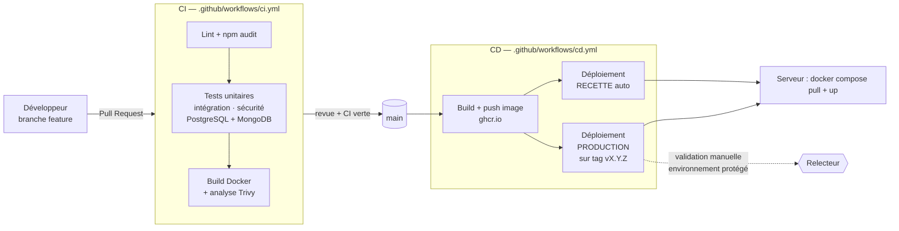

# Compétence 11 — Démarche DevOps : CI/CD, automatisation, conteneurisation

## Chaîne complète

## Intégration continue (`ci.yml`)

Déclenchée à chaque *push* sur `main` / `develop` et chaque Pull Request.

| Job | Contenu | Échec si… |
|---|---|---|
| `qualite` | `npm ci`, ESLint (serveur et composants Vue), build de l'interface Vue (Vite), `npm audit --audit-level=high --omit=dev` | une erreur de lint, un build qui échoue ou une vulnérabilité haute dans les dépendances de production |
| `tests` | Conteneurs de service PostgreSQL 16 et MongoDB 7 ; tests unitaires, puis d'intégration, puis de sécurité | un test échoue |
| `docker` | Construction de l'image, analyse **Trivy** (vulnérabilités critiques corrigeables) | l'image ne se construit pas ou contient une faille critique |

Les jobs `qualite` et `tests` s'exécutent en parallèle ; `docker` n'est lancé que s'ils réussissent. Le cache npm accélère les exécutions. La branche `main` doit être protégée (réglage GitHub : *Require status checks* sur ces trois jobs, *Require a pull request*).

## Résultats d'exécution

La chaîne a été exécutée sur GitHub Actions (dépôt `ARTHURGMD63/TitreB3`). Les premières exécutions ont échoué ; les causes ont été identifiées dans l'historique du dépôt puis corrigées, ce qui illustre l'intérêt de la CI.

| Run | Commit | CI | CD | Cause de l'échec / correction |
|---|---|---|---|---|
| #1 et #2 | `58e3e18`, `8387998` | Échec (job Docker) | Échec (déploiement) | CI : tests au vert, mais action Trivy introuvable. CD : image publiée, déploiement SSH impossible car secrets `DEPLOY_*` absents |
| #3 | `2f9fb6f` | Échec (tests de sécurité) | Échec (déploiement) | CI : le test de la CSP dépendait du build de l'interface Vue (corrigé : il vise `/api/health`). Même cause pour le CD que ci-dessus |
| #4 | `7b1c923` | Échec (job Docker) | Échec (fichier invalide) | CI : action Trivy toujours introuvable, remplacée par l'image officielle `aquasec/trivy`. CD : phrase YAML non protégée (`: ` dans un `run`) rendant le fichier invalide |
| **#5** | `27983ad` | **Succès** (1 min 21 s) | **Succès** (43 s) | Chaîne complète au vert |

État au 15 octobre 2026 :
- **CI** : lint, build de l'interface Vue, audit des dépendances, 99 tests (unitaires, intégration, sécurité), build de l'image Docker et analyse Trivy (aucune faille critique corrigeable) passent.
- **CD** : l'image est publiée sur GitHub Container Registry (`ghcr.io/arthurgmd63/titreb3`).
- **Déploiement SSH** : non exécuté, car aucun serveur n'est encore configuré. Les jobs de déploiement détectent l'absence des secrets `DEPLOY_*`, ignorent l'étape SSH et restent verts. Le déploiement s'activera dès que les secrets seront créés (voir ci-dessous).

## Livraison continue (`cd.yml`)

| Événement | Actions |
|---|---|
| Fusion sur `main` | Construction et publication de l'image `ghcr.io/arthurgmd63/titreb3:main` (+ tag du commit) → déploiement automatique en **recette** |
| Tag `vX.Y.Z` | Publication de l'image `:X.Y.Z` → job de déploiement **production**, suspendu jusqu'à approbation d'un relecteur (environnement GitHub `production` avec *Required reviewers*) |

Le déploiement se connecte en SSH au serveur et exécute `docker compose pull && up -d`, **uniquement si le secret `DEPLOY_HOST` existe** ; sinon l'étape est ignorée et le workflow reste vert. Le conteneur `migrate` applique alors les migrations avant le démarrage de la nouvelle version.

### Secrets et configuration GitHub à créer

| Où | Nom | Contenu |
|---|---|---|
| Settings → Environments → `recette` et `production` | `DEPLOY_HOST` | Adresse du serveur |
| | `DEPLOY_USER` | Utilisateur SSH de déploiement |
| | `DEPLOY_SSH_KEY` | Clé privée SSH dédiée (droits limités) |
| Environment `production` | *Required reviewers* | Au moins une personne |
| Settings → Branches → `main` | *Branch protection* | PR + vérifications CI requises |

`GITHUB_TOKEN` (fourni automatiquement) suffit pour publier sur GitHub Container Registry. Aucun secret n'est stocké dans le dépôt.

## Conteneurisation

| Élément | Choix |
|---|---|
| `Dockerfile` | Construction en 3 étapes : build de l'interface Vue (Vite), dépendances de production du serveur (`npm ci --omit=dev`), puis image finale (qui ne contient que `client/dist`, sans Node-Vite ni sources) sur `node:22-alpine` ; **utilisateur non-root** ; `HEALTHCHECK` sur `/api/health` ; aucun outil de développement ni test dans l'image |
| `docker-compose.yml` | Développement : PostgreSQL, MongoDB, Mailhog ; profil `full` pour exécuter aussi l'application (avec migrations et données de démonstration) |
| `docker-compose.prod.yml` | Recette / production : réseau interne, **aucun port de base exposé**, redémarrage automatique, volumes nommés, secrets obligatoires (`:?` fait échouer le démarrage s'ils manquent), conteneur de migration séparé qui seul connaît le mot de passe administrateur, proxy Caddy en HTTPS |
| Santé | Chaque service a un `healthcheck` ; l'ordre de démarrage s'appuie dessus (`service_healthy`, `service_completed_successfully`) |

## Automatisation

| Tâche | Automatisation |
|---|---|
| Qualité et tests | CI à chaque modification |
| Construction et publication | CD |
| Migrations de base | Conteneur `migrate` à chaque déploiement, idempotent et transactionnel |
| Clôture des réservations passées, rappels | Planificateur intégré à l'application (toutes les 5 minutes) |
| Purge du journal d'audit | Index TTL MongoDB |
| Certificats TLS | Caddy (obtention et renouvellement automatiques) |
| Nettoyage des images | `docker image prune` à chaque déploiement |

## Collaboration avec l'équipe d'exploitation

- **Contrat d'exploitation** : variables d'environnement documentées (`.env.example`, `deploy/.env.prod.example`), point de santé `/api/health`, journaux sur la sortie standard (collectables par n'importe quel outil), arrêt propre sur `SIGTERM`.
- **Documentation** : [09-deploiement.md](09-deploiement.md) (installation, mise à jour, retour arrière, sauvegarde, dépannage) rédigée pour être suivie sans connaître le code.
- **Revue conjointe** : les fichiers `Dockerfile`, `docker-compose.prod.yml` et `.github/workflows/` sont relus en Pull Request par l'exploitation.
- **Retour d'expérience** : incidents analysés sans recherche de coupable, actions correctives ajoutées au backlog.

## Évolutions possibles

Supervision (Prometheus / Grafana ou service d'uptime), centralisation des journaux, sauvegardes automatisées chiffrées, déploiement sans interruption (*blue / green*), signature des images, rapport de couverture publié par la CI.
